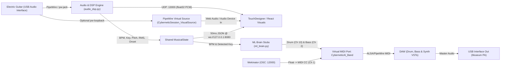

# The Cybernetic Session

Central low-latency audio routing, DSP extraction, ML MIDI generation, Wekinator OSC-to-MIDI CC, and visual telemetry hub for **"The Cybernetic Session"** interactive museum installation.

---

## 1. System Architecture Overview

The installation runs on a single **CachyOS (Arch Linux)** machine using **PipeWire** as the unified audio/MIDI fabric. A live electric guitar drives an AI rhythm section in a DAW while simultaneously feeding real-time audio and DSP telemetry to visuals (TouchDesigner / React).



### Repository Layout
```text
FootAI/
├── cybernetic_session/
│   ├── __init__.py
│   ├── config.py          # SessionConfig & thread-safe MusicalState
│   ├── audio_dsp.py       # Sounddevice ingress, UDP PCM broadcast, Aubio/Librosa/CREPE DSP
│   ├── ml_brain.py        # DrumRNN & MelodyRNN stubs + drift-free 16-step sequencer
│   ├── midi_egress.py     # Virtual ALSA MIDI port ("CyberneticAI_Band") via mido/rtmidi
│   ├── osc_wekinator.py   # AsyncIO OSC server (:12000) -> MIDI CC
│   ├── ws_telemetry.py    # AsyncIO WebSocket server (:8080) @ 20 Hz
│   └── main.py            # CLI & subsystem orchestrator
├── scripts/
│   └── setup_pipewire_loopback.sh  # Standalone pw-loopback Virtual Source helper
├── run_session.py         # Top-level executable entrypoint
├── requirements.txt       # Python dependencies
└── README.md              # Monolith documentation
```

---

## 2. Setup & Installation (CachyOS / Arch Linux)

### 2.1 System Dependencies
Install PipeWire, JACK compatibility, `qpwgraph`, and native audio/MIDI build headers:

```bash
sudo pacman -S --needed \
  pipewire pipewire-jack pipewire-alsa pipewire-pulse wireplumber \
  qpwgraph portaudio alsa-lib aubio python-pip python-virtualenv
```

### 2.2 Python Environment
Create and activate a virtual environment, then install Python packages:

```bash
python -m venv .venv
source .venv/bin/activate
pip install --upgrade pip
pip install -r requirements.txt
```

> **Optional Neural Pitch Backend (`crepe`):**  
> By default, the script uses `aubio` (`yinfft`) for sub-20ms pitch detection. If you want neural pitch tracking via `crepe`, uncomment `crepe` and `tensorflow` in `requirements.txt`, install them, and run with `--pitch-backend crepe`.

### 2.3 Running the Router
Launch under `pw-jack` so `sounddevice` exposes a native JACK/PipeWire node inside `qpwgraph`:

```bash
pw-jack python run_session.py
```

Useful CLI flags:
```bash
pw-jack python run_session.py --list-devices          # Inspect audio devices
pw-jack python run_session.py --pipewire-loopback     # Also spawn pw-loopback Virtual Source
pw-jack python run_session.py --pitch-backend librosa # Use librosa.yin instead of aubio
pw-jack python run_session.py --block-size 256 -v     # Lower latency (~5.3ms) + debug logs
```

---

## 3. API & Interface Contracts

### 3.1 Visual Telemetry WebSocket (`ws://127.0.0.1:8080`)
The WebSocket server broadcasts a JSON object every **50 ms (20 Hz)** to all connected clients.

#### JSON Schema
```json
{
  "timestamp": 1763042450.123456,
  "bpm": 122.45,
  "detected_pitch": {
    "hz": 110.0,
    "note": "A2",
    "midi": 45,
    "key": "A"
  },
  "rms": 0.08412,
  "spectral_centroid_hz": 1420.55,
  "onset": true
}
```

| Field | Type | Description |
| :--- | :--- | :--- |
| `timestamp` | `float` | Unix epoch seconds when the snapshot was generated. |
| `bpm` | `float` | Live tempo estimate in BPM (clamped `40.0`–`240.0`). |
| `detected_pitch.hz` | `float` | Fundamental frequency in Hz (`0.0` when below noise gate). |
| `detected_pitch.note` | `string` | Nearest equal-temperament note name (e.g., `"E2"`, `"A2"`, `"N/A"`). |
| `detected_pitch.midi` | `int` | MIDI note number (`0`–`127`). |
| `detected_pitch.key` | `string` | Pitch class (`"C"`, `"C#"`, ..., `"B"`), used by the ML bass generator. |
| `rms` | `float` | Linear RMS amplitude of the latest 512-sample frame (`0.0`–`1.0`). |
| `spectral_centroid_hz` | `float` | Spectral centroid ("brightness") in Hz. |
| `onset` | `bool` | `true` if a guitar transient/onset occurred since the last broadcast. |

---

### 3.2 Wekinator OSC Server (`udp://127.0.0.1:12000`)
Incoming OSC float messages on port **12000** are converted to MIDI CC (`0`–`127`) on **MIDI Channel 1** and emitted through `CyberneticAI_Band`.

* **Float normalization:** Values in `[0.0, 1.0]` are scaled linearly to `0`–`127`. Values `> 1.0` are clamped to `0`–`127`.

| OSC Address | Arguments | Target MIDI CC (Channel 1) |
| :--- | :--- | :--- |
| `/wek/outputs` | `float0, float1, float2, ...` | Maps sequentially to CC `[74, 71, 1, 11, 20, 21, 22, 23]` (74 = Cutoff, 71 = Resonance, 1 = Mod Wheel, 11 = Expression) |
| `/cybernetic/cc/<num>` | `float` | Explicit MIDI CC `<num>` (`0`–`127`) |
| `/cybernetic/rms` | `float` | CC `74` (Filter Cutoff / Brightness) |
| `/cybernetic/centroid` | `float` | CC `71` (Filter Resonance / Timbre) |

---

### 3.3 Live Audio Stream for Visuals
Two options are provided for TouchDesigner and React:

#### Option A: Low-Latency UDP Broadcast (`127.0.0.1:13000`)
Every audio callback pushes a raw PCM datagram immediately to `127.0.0.1:13000`:
* **Sample Rate:** `48000 Hz`
* **Channels:** `1` (Mono)
* **Sample Format:** `32-bit IEEE Float` (`float32`, little-endian)
* **Chunk Size:** `512` samples (`2048 bytes` per UDP packet, ~`10.67 ms`)

In **TouchDesigner**, use a **UDP In DAT** / **Audio Stream In** or a small Python script DAT unpacking `struct.unpack('<512f', packet)` into a Script CHOP.

#### Option B: PipeWire Virtual Source (Recommended for React / Web Audio API & TouchDesigner)
Run with `--pipewire-loopback` (or execute `./scripts/setup_pipewire_loopback.sh` in a separate terminal). This creates a system-wide virtual microphone named **`Cybernetic Session Visual Audio`**:
* **React / Browser:** Call `navigator.mediaDevices.getUserMedia({ audio: { deviceId: ... } })` and select `"Cybernetic Session Visual Audio"` -> feed into `AnalyserNode`.
* **TouchDesigner:** Add an **Audio Device In CHOP** and select `"Cybernetic Session Visual Audio"`.

---

## 4. `qpwgraph` Routing Map

Open `qpwgraph` after starting `pw-jack python run_session.py` and your DAW:

1. **Guitar -> Python DSP ("The Ears")**
   * Connect **`<Your USB Audio Interface> capture_FL`** (the guitar input channel) $\rightarrow$ **`PortAudio` / `python3` input**.
2. **Guitar -> Visuals Virtual Source (if using `pw-loopback`)**
   * Connect **`<Your USB Audio Interface> capture_FL`** $\rightarrow$ **`CyberneticSession_VisualIn` playback_FL**.
3. **Python Virtual MIDI -> DAW**
   * Connect **`CyberneticAI_Band` (MIDI Out)** $\rightarrow$ **DAW MIDI Input**:
     * **Track 1 (Drums VST):** Listen on **MIDI Channel 10** (GM Kick `36`, Snare `38`, Closed Hat `42`).
     * **Track 2 (Bass VST):** Listen on **MIDI Channel 2**.
     * **Track 3 (Modulated Synth / Guitar FX):** Listen on **MIDI Channel 1** for Wekinator MIDI CCs (`CC 74`, `CC 71`, etc.).
4. **DAW -> Museum Speakers**
   * Connect **DAW Master Out `1 / 2`** $\rightarrow$ **`<Your USB Audio Interface> playback_FL / playback_FR`**.

---

## 5. ML Team Integration Guide

The ML generation boundary lives in [`cybernetic_session/ml_brain.py`](file:///home/boxa/FootAI/cybernetic_session/ml_brain.py):

* `generate_drum_midi(bpm: float) -> list[MidiStepEvent]`
* `generate_bass_midi(key: str, bpm: float) -> list[MidiStepEvent]`

Both functions are called once per 4/4 bar on the dedicated `MLSequencer` thread. To swap in **DrumRNN** and **MelodyRNN**, replace the mock pattern logic inside those two functions while returning `MidiStepEvent(step=0..15, note=0..127, velocity=1..127, duration_steps=1..16)`.
