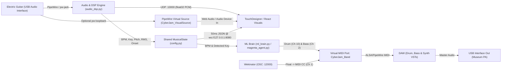

# System Architecture

**CyberJam** is a monolithic, low-latency interactive installation running on CachyOS (Arch Linux) with PipeWire. A live electric guitar feeds real-time DSP extraction, symbolic ML accompaniment, Wekinator expressive modulation, and visual telemetry/audio streams.

## Data Flow Diagram

## Concurrency Model

To guarantee sub-50ms audio responsiveness with zero dropouts:

1. **Real-Time Audio Callback (`sounddevice.InputStream`):**
   - Never allocates heavily or blocks.
   - Sends raw `float32` mono PCM chunks immediately over non-blocking UDP (`127.0.0.1:13000`).
   - Enqueues audio frames into a bounded `queue.Queue(maxsize=32)` (dropping the oldest frame if full).
2. **DSP Worker Thread (`CyberJamDSPWorker`):**
   - Consumes audio frames from the queue, computes RMS, spectral centroid, onset, BPM, and fundamental pitch/key, and updates the lock-protected `MusicalState`.
3. **ML Sequencer Thread (`CyberJamMLSequencer`):**
   - Runs a drift-compensated `time.perf_counter()` 16th-note clock, querying `MusicalState` at bar boundaries and sending `note_on` / `note_off` via thread-safe `MidiEgress`.
4. **AsyncIO Event Loop (`main.py`):**
   - Hosts `WekinatorOSCServer` (`AsyncIOOSCUDPServer` on `127.0.0.1:12000`) and `VisualTelemetryServer` (`websockets` on `127.0.0.1:8080`).

## Module Map

| File | Responsibility |
| :--- | :--- |
| `run_session.py` | Top-level executable launcher |
| `cyberjam/config.py` | `SessionConfig` defaults & thread-safe `MusicalState` |
| `cyberjam/tempo.py` | Guitar-optimised comb/autocorrelation BPM estimator + `GuitarTempoTracker` |
| `cyberjam/audio_dsp.py` | Audio ingress, UDP PCM broadcast, `PipeWireLoopback`, DSP worker |
| `cyberjam/ml_brain.py` | `generate_drum_midi`, `generate_bass_midi` stubs & `MLSequencer` |
| `cyberjam/midi_egress.py` | Thread-safe `CyberJam_Band` virtual ALSA MIDI port |
| `cyberjam/osc_wekinator.py` | OSC-to-MIDI CC server on port `12000` |
| `cyberjam/ws_telemetry.py` | 20 Hz JSON WebSocket broadcaster on port `8080` |
| `cyberjam/main.py` | CLI parser & graceful `SIGINT`/`SIGTERM` orchestrator |
| `magenta_agent.py` | Standalone `MagentaAgent` for TensorFlow `.mag` RNN MIDI generation |
| `scripts/setup_pipewire_loopback.sh` | Standalone `pw-loopback` Virtual Source script |
