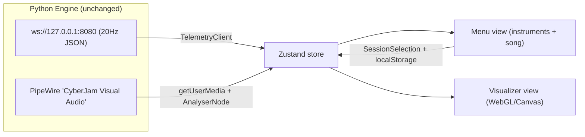
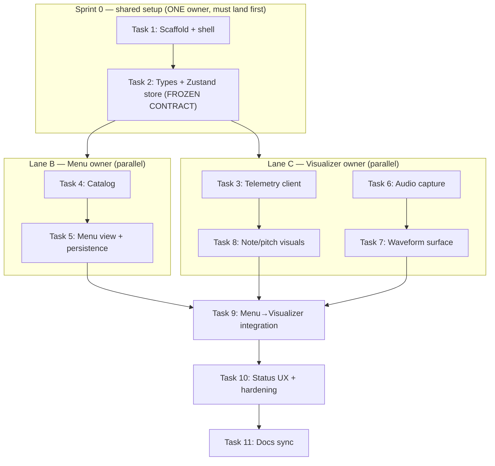

# React Visualizer — Implementation Plan

The **CyberJam Visualizer** is a standalone React web application for the installation. It
consumes the existing (unmodified) Python engine APIs and provides two features:

1. **Menu** — choose the song and the instruments for the session; starting Freestyle automatically begins a two-bar (eight-measure) tempo-capture before the backing band starts.
2. **Visualizer** — render the guitar notes you play (from DSP telemetry) and a live waveform
   of the audio, while the DAW/speakers produce the ML accompaniment audio.

**Two-window / two-screen layout:** one running dev-server instance serves three hash routes
(`#/` launcher, `#/menu`, `#/visualizer`). On load, the launcher **automatically attempts to open
both screens as separate browser windows** (one per screen); if the browser blocks the popups it
falls back to a single "Open both screens" button. The operator adjusts the Menu in real time on
screen 1 while screen 2 shows the full Visualizer. The two windows share the user's `selection`
live via the **BroadcastChannel** API (client-side only, no backend). There is no in-app
navigation chrome — each view fills its window.

> [!IMPORTANT]
> This subsystem does **not** modify the Python engine, open any new ports, or add a backend.
> It only *pulls* the documented contracts in
> [`contracts-and-apis.md`](./contracts-and-apis.md) and [`audio-and-routing.md`](./audio-and-routing.md).

---

## 1. Scope & Decisions

| Decision | Choice |
| :--- | :--- |
| Framework | Full **React** (no TouchDesigner, no new Python backend) |
| Build tool / language | **Vite** + **React** + **TypeScript** |
| Live audio path | PipeWire Virtual Source **`"CyberJam Visual Audio"`** via `navigator.mediaDevices.getUserMedia` → Web Audio `AnalyserNode` (Option B in [`audio-and-routing.md`](./audio-and-routing.md)) |
| Telemetry | WebSocket `ws://127.0.0.1:8080`, 20 Hz JSON |
| Visual rendering | **PixiJS** (2D WebGL/Canvas) — pinned in Task 1; chosen over react-three-fiber as the lighter, more direct fit for 2D waveform/spectrum/note-lane visuals driven from an `AnalyserNode` |
| State management | **Zustand** |
| Window / navigation model | **Two separate browser windows** (one per screen) via a dependency-free **hash router** (`#/`, `#/menu`, `#/visualizer`). The `#/` launcher **auto-opens both windows** (`window.open`) with a blocked-popup fallback button; no in-app nav chrome. Live cross-window `selection` sync via **BroadcastChannel** |
| Tests | **Vitest** + **React Testing Library** (jsdom) |
| Menu selections | **Local app state only** (React state + `localStorage`); no backend writes |
| ML instrument audio | Produced by the **DAW/speakers** (out of scope); the app visualizes only |

### Excluded on purpose
- **Raw UDP `:13000` PCM** — not accessible from a browser; the PipeWire Virtual Source path is
  used instead. Live audio therefore requires the engine launched with `--pipewire-loopback`.
- **OSC `:12000`** — reference-only; the app never opens it.
- **`CyberJam_Band` MIDI** — originally reference-only, but **Extension track E** now *reads* it
  via the browser **Web MIDI API** (input only, never output) to drive the band note ribbon.
  Channel roles are shown as lane labels (Ch 1 CC, Ch 2 bass, Ch 10 drums). This opens no new port
  and does not modify the engine.

---

## 2. Contracts Consumed (from existing docs)

### 2.1 Telemetry WebSocket (`ws://127.0.0.1:8080`, 20 Hz)
One JSON object every **50 ms**. See [`contracts-and-apis.md`](./contracts-and-apis.md) §1 for the
authoritative schema.

```json
{
  "timestamp": 1763042450.123456,
  "bpm": 122.45,
  "detected_pitch": { "hz": 110.0, "note": "A2", "midi": 45, "key": "A" },
  "rms": 0.08412,
  "spectral_centroid_hz": 1420.55,
  "onset": true
}
```

Client guards to respect:
- `detected_pitch.hz == 0.0` / `note == "N/A"` → below noise gate; suppress the active-note display.
- `onset` is `true` only **once** per transient (consumed each broadcast) → do not re-trigger the
  pulse until a new `onset: true` arrives.
- `bpm` is clamped `40.0`–`240.0` upstream; treat socket data as untrusted and validate shape.

### 2.2 Live Audio (PipeWire Virtual Source)
Launch the engine with `--pipewire-loopback` to expose the system-wide virtual microphone
**`"CyberJam Visual Audio"`**. In the browser: `getUserMedia` selecting that device → `AnalyserNode`.

### 2.3 Engine defaults (reference)
From `cyberjam/config.py`: ws host/port `127.0.0.1:8080`, interval `50 ms`, default BPM `120`,
default key `E`.

---

## 3. Architecture

A single Vite + React + TS SPA with a two-view shell (Menu ↔ Visualizer). A typed data layer wraps
(a) the telemetry WebSocket and (b) the Web Audio capture, exposing live data through a Zustand
store. The Menu writes a `SessionSelection` into the store (persisted to `localStorage`); the
Visualizer reads both the live telemetry and the selection to render note/pitch/onset/waveform
visuals on a WebGL/Canvas surface. Everything is testable headless by mocking `WebSocket` and
`navigator.mediaDevices`.



---

## 4. Parallelization Plan (How Two People Work at Once)

The work is organized so the **Menu** and **Visualizer** features are built **in parallel** by two
owners after one short shared setup. The only serial part is **Sprint 0** (scaffold + frozen
contracts); everything else forks into two independent lanes that merge at the end.



**The frozen contract (produced in Task 2, do not change unilaterally after Sprint 0):**
- `TelemetryFrame` — the telemetry JSON shape (Visualizer lane reads it).
- `SessionSelection` — `{ songId, instrumentIds, mode }` where `mode` is the per-song difficulty
  (`"beginner" | "experienced" | null`; always null for Freestyle). The Menu lane writes it; the
  Visualizer lane reads it in Task 9.
- The Zustand store slices `latestFrame`, `connectionStatus`, `audioStatus`, `selection` and their
  actions.
- The `catalog.ts` instrument/song entry types (`id`, `lane`, `displayColor`, `midiChannel`,
  `referenceBpm`, `referenceKey`).

Freezing these four things up front is what lets the two lanes never block each other. If a change
to the contract becomes necessary, both owners agree first, then Task 2 is updated in a shared PR.

**Parallel-safe conventions (avoid merge collisions):**
- **File ownership by folder.** Menu lane owns `src/menu/**` and `src/data/catalog.ts`; Visualizer
  lane owns `src/visualizer/**` and `src/telemetry/**` and `src/audio/**`. Shared files
  (`src/store.ts`, `src/types.ts`, `src/config.ts`, `src/App.tsx`) are touched only in Sprint 0 and
  at the Task 9/10 merge points.
- **One sub-branch per lane** off the integration branch: `feat/react-visualizer-menu` and
  `feat/react-visualizer-visualizer`, both branched from `feat/react-visualizer` after Sprint 0
  lands. Rebase on the integration branch before opening the merge PR.
- **Mocked data unblocks both lanes.** Neither lane needs the live Python engine to build or test:
  the Menu lane uses the store directly; the Visualizer lane uses a mock `WebSocket` and mock
  `navigator.mediaDevices`. Live-engine verification happens at Task 9/10.
- **Each task stays independently demoable and test-covered** so a lane can be reviewed and merged
  without waiting for the other.

**Suggested assignment:**

| Lane | Owner | Tasks | Depends on | Blocks |
| :--- | :--- | :--- | :--- | :--- |
| Sprint 0 | Either (pair) | 1, 2 | — | everything |
| Lane B — Menu | Person 1 | 4, 5 | Task 2 | Task 9 |
| Lane C — Visualizer | Person 2 | 3, 6, 7, 8 | Task 2 | Task 9 |
| Integration | Either (pair) | 9, 10, 11 | Lanes B + C | — |

---

## 5. Task Breakdown (Spec-Driven)

Each task is a working, demoable increment, test-driven, with no orphaned code. The
**Lane** / **Depends on** / **Parallel with** fields define the execution order; tasks in different
lanes with the same dependency can run simultaneously.

### Sprint 0 — Shared setup (serial; must land before the lanes fork)

- [x] **Task 1: Scaffold the Vite + React + TS app with tooling and a two-view shell.** ✅ *Done (Sprint 0).*
  - *Lane:* Sprint 0 (shared). *Depends on:* none. *Parallel with:* none — blocks everything.
  - *Objective:* Create the project (Vite `react-ts` template) with Zustand, Vitest + React Testing
    Library, and a chosen visual lib (react-three-fiber or PixiJS) installed with pinned versions.
    Add an `App` shell with tab navigation between **Menu** and **Visualizer** views (placeholders).
  - *Guidance:* Put config constants (ws URL `ws://127.0.0.1:8080`, reconnect interval, audio device
    label `"CyberJam Visual Audio"`) in `src/config.ts`. Set up `vitest.config.ts` with jsdom.
  - *Tests:* Render `App`; assert both tab buttons exist and clicking toggles the active view.
  - *Demo:* `npm run dev` opens the app; user switches between empty Menu and Visualizer tabs;
    `npm test` passes.
  - *Result:* Project created under `visualizer/`. PixiJS pinned as the visual lib. Shell in
    `src/App.tsx` is a **dependency-free hash router** (`src/router.ts`) with three routes — `#/`
    (launcher), `#/menu`, `#/visualizer` — so each view opens in its own browser window (one per
    screen). The launcher **auto-opens both windows** on mount via `window.open` (`src/windows.ts`),
    falling back to an "Open both screens" button when popups are blocked; the in-app nav links were
    removed (title + debug bar only). Live cross-window `selection` sync via **BroadcastChannel**
    (`src/sync.ts` + `useSelectionSync`). `MenuView`/`VisualizerView` placeholders. Config constants
    in `src/config.ts`. `vitest.config.ts` uses jsdom. Verified: `npm run typecheck`, `npm test`
    (22 passing: launcher auto-open + blocked fallback, routing, store, router parsing, cross-window
    sync), and `npm run build` all green on branch `feat/react-visualizer`.
  - *Note:* The original in-page tab toggle was replaced by the two-window routing model, then the
    launcher was upgraded to auto-open both windows and the header nav links removed, per later
    requirements (one screen per view, real-time Menu, live Visualizer).

- [x] **Task 2: Define typed data contracts and the Zustand store. (FROZEN CONTRACT)** ✅ *Done (Sprint 0).*
  - *Lane:* Sprint 0 (shared). *Depends on:* Task 1. *Parallel with:* none — blocks both lanes.
  - *Objective:* Create TS types mirroring the telemetry JSON (`TelemetryFrame` with nested
    `detected_pitch`) and the `SessionSelection` type (selected song, selected instruments). Create a
    Zustand store holding `latestFrame`, `connectionStatus`, `audioStatus`, and `selection`, with
    actions to update each.
  - *Guidance:* Types must match [`contracts-and-apis.md`](./contracts-and-apis.md) exactly. Keep
    selection defaults aligned with engine defaults (BPM 120, key E) where relevant. **This task
    freezes the Menu↔Visualizer contract — after it lands, changes to these types require both lane
    owners to agree.**
  - *Tests:* Unit-test store actions (set frame, set selection, set statuses) and initial state.
  - *Demo:* A temporary debug panel renders `connectionStatus` and `selection` from the store.
  - *Result:* Frozen contract in `src/types.ts` (`TelemetryFrame`/`DetectedPitch` matching the JSON
    schema exactly, `SessionSelection` = `{ songId, instrumentIds, mode }`, status unions, and the
    `InstrumentEntry`/`SongEntry` catalog types). Store in `src/store.ts` with `latestFrame`,
    `connectionStatus`, `audioStatus`, `selection` slices and actions (navigation moved to the hash
    router, so there is no `view` slice). Temporary `DebugPanel` renders status + selection. Engine
    defaults mirrored in `src/config.ts` (`DEFAULT_BPM`/`DEFAULT_KEY`). Verified by store unit
    tests.

### Lane B — Menu feature (parallel with Lane C)

- [x] **Task 4: Instrument & song data model + static catalog.** ✅ *Done (Lane B).*
  - *Lane:* B (Menu). *Depends on:* Task 2. *Parallel with:* all of Lane C.
  - *Objective:* Define the catalog of selectable **instruments** (mapped to documented roles/MIDI
    channels for display — Drums = Ch 10, Bass = Ch 2, Synth/FX = Ch 1) and **songs** (static list
    with title, reference BPM, reference key — e.g., the Cargo song). Provide a typed `catalog.ts`
    and selectors.
  - *Guidance:* Instrument entries carry a `displayColor` and `lane` used later by the Visualizer.
    Songs carry `referenceBpm`/`referenceKey` for Visualizer overlays. No network calls.
  - *Tests:* Catalog integrity (unique ids, valid channels, colors present); selector helpers.
  - *Demo:* A temporary list renders all instruments and songs from the catalog.
  - *Result:* Static catalog in `src/data/catalog.ts` using the frozen `InstrumentEntry`/`SongEntry`
    types (no network calls). Instruments: **Drums** (lane 0, MIDI Ch 10), **Bass** (lane 1, Ch 2),
    **Synth / FX** (lane 2, Ch 1), each with a `displayColor`; channels match
    [`contracts-and-apis.md`](./contracts-and-apis.md) §3. Songs: **Freestyle** (`freestyle`, a
    guitar-led jam where the ML drums + bass are generated to follow the player — `freestyle: true`,
    no fixed tempo/key target), **Cargo** (`cargo-song`, 128 BPM, key E) and **Free Jam** (engine
    defaults, 120 BPM, key E). Selectors: `getInstrumentById`,
    `getSongById`, `getInstrumentsByIds` (catalog lane order, drops unknowns), `isValidInstrumentId`,
    `isValidSongId`. `MenuView` renders a temporary read-only list of the catalog (replaced by the
    interactive pickers in Task 5). Verified: `npm run typecheck`, `npm test` (37 passing, incl. 15
    new catalog integrity + selector tests), and `npm run build` all green on branch
    `feat/react-visualizer-menu-catalog`.

- [x] **Task 5: Menu view UI — selection and persistence.** ✅ *Done (Lane B).*
  - *Lane:* B (Menu). *Depends on:* Task 4. *Parallel with:* all of Lane C.
  - *Objective:* Build the Menu view: a song picker (single select) and an instrument picker
    (multi-select toggles), writing choices into the store's `selection` and persisting to
    `localStorage`; rehydrate on app load. Add a "Start / Go to Visualizer" action.
  - *Guidance:* Accessible controls (labeled inputs, keyboard operable, ARIA toggle state). Persist
    via a small `localStorage` wrapper; guard against corrupt stored JSON.
  - *Tests:* RTL — selecting a song and instruments updates the store; reload (re-mount with seeded
    `localStorage`) restores selection; corrupt storage falls back to defaults.
  - *Demo:* Pick the Cargo song + instruments, reload → selection persists; "Start" navigates to the
    Visualizer.
  - *Result:* `MenuView` (`src/views/MenuView.tsx`) renders a single-select song radio group and
    multi-select instrument toggle buttons (`aria-pressed`), writing through the store's `setSong` /
    `toggleInstrument` actions (so `useSelectionSync` mirrors changes to the Visualizer window). A
    small localStorage wrapper (`src/menu/persistence.ts`, key `cyberjam.selection`) persists on
    every change and rehydrates on mount; `loadSelection` sanitizes against the catalog — unknown
    song/instrument ids and corrupt/non-object JSON fall back to the empty selection, and instrument
    ids are de-duplicated. "Start / Go to Visualizer" is disabled until a song is chosen, then sets
    the hash to `#/visualizer`. Verified: `npm run typecheck`, `npm test` (49 passing, incl. 7
    persistence + 5 Menu RTL tests), and `npm run build` all green on branch
    `feat/react-visualizer-menu-catalog`.
  - *Enhancement (controller support + Rocksmith-style UI):* The Menu was redesigned with a
    friendlier, game-like aesthetic (dark gradient hero, large song/instrument "cards" with a glowing
    cyan focus ring, per-instrument accent colors from the catalog `displayColor`, and a prominent
    "Start Session" call-to-action). Full **gamepad** navigation was added via a polling hook
    (`src/menu/useGamepad.ts`): a `requestAnimationFrame` loop reads `navigator.getGamepads()` and
    emits *edge-triggered* semantic actions (D-pad/left-stick → up/down/left/right, A → confirm,
    B → back, Start → launch) for a standard-mapping controller. The view keeps a single focus cursor
    across songs → instruments → Start; D-pad moves it, A activates the focused item, and a live hint
    shows when a controller connects. Mouse and keyboard still work (hover syncs focus; radio/toggle
    semantics preserved via `role="radio"`/`aria-pressed`). Tests: pure `readActions`/`stepActions`
    units cover button/axis mapping and rising-edge detection (6 new). Re-verified: `npm run
    typecheck`, `npm test` (55 passing), and `npm run build` all green.
  - *Enhancement (song option + difficulty mode):* Added a **Freestyle** catalog entry (guitar-led
    jam, `freestyle: true`; see Task 4). Added a per-song **difficulty mode** step
    (`beginner | experienced`) stored on `SessionSelection.mode`: after a real song is picked the
    Menu shows a "Mode" card group (single-select radios, in the controller focus ring between songs
    and instruments); Start stays disabled until a mode is chosen. **Freestyle skips the mode step**
    and can start immediately. `setSong` clears `mode` so it is re-chosen per song; persistence
    sanitizes `mode` to the two valid values. The actual beginner chord-diagram / approaching-timing-
    circle Visualizer rendering is a later task; this change only establishes the data model + menu
    UI. Re-verified: `npm run typecheck`, `npm test` (176 passing), and `npm run build` all green on
    branch `feat/menu-freestyle-song`.

### Lane C — Visualizer feature (parallel with Lane B)

- [x] **Task 3: Telemetry WebSocket client with reconnect and validation.** ✅ *Done (Lane C).*
  - *Lane:* C (Visualizer). *Depends on:* Task 2. *Parallel with:* all of Lane B; independent of
    Tasks 6/7 within this lane.
  - *Objective:* Implement a `TelemetryClient` that connects to `ws://127.0.0.1:8080`, parses JSON
    into `TelemetryFrame`, validates/guards malformed frames, pushes valid frames into the store, and
    auto-reconnects with backoff. Expose a `useTelemetry()` hook tied to component lifecycle. 
  - *Guidance:* Treat all socket data as untrusted — validate shape and clamp/guard before storing
    (e.g., ignore frames missing `detected_pitch`). Surface `connectionStatus`
    (`connecting | open | closed | error`). Build/test entirely against a mock `WebSocket` — no live
    engine required.
  - *Tests:* Mock `WebSocket`; assert valid frames update the store, malformed frames are dropped,
    and a close triggers a reconnect attempt.
  - *Demo:* With `run_session.py` running, the debug panel shows live `bpm`/`note`/`onset` at ~20 Hz;
    status flips to `open`. Without the engine, status shows reconnect attempts.
  - *Result:* `src/telemetry/client.ts` (`parseTelemetryFrame` validator + `TelemetryClient` with an
    injectable socket factory & exponential backoff capped at `TELEMETRY_RECONNECT_MAX_MS`) and
    `src/telemetry/useTelemetry.ts` (hook pushing frames/status into the store). 9 unit tests cover
    valid/malformed frames, reconnect-on-close, and no-reconnect-after-stop.

- [x] **Task 6: Web Audio capture from the PipeWire Virtual Source.** ✅ *Done (Lane C).*
  - *Lane:* C (Visualizer). *Depends on:* Task 2. *Parallel with:* all of Lane B; independent of
    Tasks 3/8 within this lane.
  - *Objective:* Implement an `AudioCapture` module that enumerates input devices, selects
    `"CyberJam Visual Audio"` via `getUserMedia`, and exposes an `AnalyserNode` (time-domain +
    frequency getters). Provide a `useAudioCapture()` hook managing permission, start/stop, and
    `audioStatus` (`idle | requesting | active | denied | device-missing`).
  - *Guidance:* Require a user gesture to start audio (autoplay policy). Handle device-not-found with
    a clear message to launch the engine with `--pipewire-loopback`. Clean up tracks/AudioContext on
    unmount.
  - *Tests:* Mock `enumerateDevices`/`getUserMedia`; assert device selection by label, status
    transitions, denied/missing handling, and teardown.
  - *Demo:* "Enable Audio" activates capture; `audioStatus` shows `active` (or a clear message if the
    virtual device is absent).
  - *Result:* `src/audio/capture.ts` (`findVisualAudioDeviceId`, `AudioCapture` with an injectable
    `MediaProvider` wrapping `enumerateDevices`/`getUserMedia`/`AudioContext`, exposing an
    `AnalyserNode`) and `src/audio/useAudioCapture.ts` (hook with gesture-driven `start()`, store
    `audioStatus` mirroring, and unmount teardown). 7 unit tests cover device selection, active/
    denied/device-missing transitions, and track/context cleanup.

- [x] **Task 7: Live waveform/spectrum rendering surface.** ✅ *Done (Lane C).*
  - *Lane:* C (Visualizer). *Depends on:* Task 6. *Parallel with:* all of Lane B.
  - *Objective:* Build the WebGL/Canvas render surface driven by the `AnalyserNode`, drawing a
    real-time waveform and/or spectrum in a `requestAnimationFrame` loop.
  - *Guidance:* Decouple the render loop from React re-renders (read analyser buffers directly).
    Handle container resize; cap/cleanup the RAF loop on unmount to avoid leaks.
  - *Tests:* Pure buffer→drawing-data transform; mount/unmount starts/stops the RAF loop (mock RAF).
  - *Demo:* With audio active, playing guitar shows a live reacting waveform/spectrum.
  - *Result:* Pure transforms in `src/visualizer/waveform.ts` (`timeDomainToPoints`,
    `frequencyToBars`) + an injectable `RenderLoop` (`src/visualizer/renderLoop.ts`) decoupled from
    React. `src/visualizer/WaveformCanvas.tsx` drives a PixiJS `Graphics` surface from the analyser
    each RAF, with resize via `resizeTo` and full teardown (`loop.stop()` + `app.destroy`) on
    unmount. 7 unit tests cover the transforms and RAF start/stop/idempotency.

- [x] **Task 8: Note & pitch visualization from telemetry.** ✅ *Done (Lane C).*
  - *Lane:* C (Visualizer). *Depends on:* Task 3. *Parallel with:* all of Lane B.
  - *Objective:* Render the "notes you play" from telemetry: current `detected_pitch.note`/`midi`/
    `key`, a pitch history trail, and a flash/pulse on `onset`. Map `rms` to intensity and
    `spectral_centroid_hz` to color/brightness. Suppress display when `hz == 0.0` / `note == "N/A"`.
  - *Guidance:* Drive visuals from the store's `latestFrame`; keep a short rolling history (ring
    buffer) for the trail. Respect onset-once semantics.
  - *Tests:* Pure mapping functions (frame → visual props, midi → lane/position, centroid → color)
    with boundary cases (hz=0, note "N/A", onset toggling, clamped bpm/rms).
  - *Demo:* Playing a note shows the correct name + a pitch marker; strumming triggers onset pulses;
    silence clears the active-note indicator.
  - *Result:* Pure mappings in `src/visualizer/noteVisuals.ts` (`frameToNoteVisual`, `midiToPosition`,
    `centroidToColor`, `clamp`/`isSilent`) plus an `OnsetTracker` (fires once per new onset frame via
    timestamp) and a bounded `PitchHistory` ring buffer. `src/visualizer/NotePitchPanel.tsx` renders
    the current note, a pitch marker (intensity-scaled glow, centroid color), an onset pulse, and the
    history trail, driven by the store's `latestFrame`; silence (`hz==0`/`note=="N/A"`) clears the
    readout. 11 unit tests cover the mappings, onset-once, and ring-buffer bounds.
  - *Wiring:* `VisualizerView` now calls `useTelemetry()` + `useAudioCapture()`, shows a telemetry/
    audio status bar with an "Enable Audio" gesture button (incl. the `--pipewire-loopback`
    device-missing guidance), and mounts `WaveformCanvas` + `NotePitchPanel`.

### Integration track (serial; after both lanes merge)

- [x] **Task 9: Apply Menu selection to the Visualizer + reference overlays.** ✅ *Done (Integration).*
  - *Lane:* Integration. *Depends on:* Lane B (Task 5) **and** Lane C (Tasks 7, 8). *Parallel with:*
    none — this is the first merge point.
  - *Objective:* Use the store's `selection` to drive Visualizer appearance: show only the chosen
    instrument lanes with their `displayColor`, and render song reference overlays (title,
    `referenceBpm` vs live `bpm`, `referenceKey` vs detected `key`). Label lanes with their MIDI roles
    (Ch 1/2/10).
  - *Guidance:* Integration task that ties Menu → Visualizer with no orphaned catalog data. Handle
    "no selection yet" with a sensible default view.
  - *Tests:* Given a seeded selection, assert only selected lanes render and overlays show the right
    reference values; changing selection updates the view.
  - *Demo:* Cargo song + chosen instruments now shape the live Visualizer (lanes, colors, tempo/key
    reference), with note + waveform visuals running together.
  - *Result:* Pure mapping layer in `src/visualizer/selectionView.ts` — `instrumentIdToRole`
    (drums→drums Ch10, bass→bass Ch2, synth-fx→cc Ch1), `activeLanes`/`activeRoles` (selected
    instruments in catalog lane order, or **all** lanes when nothing is selected),
    `filterEventsBySelection` (keeps only band events for active roles), `selectedSong`, and
    `compareBpm`/`compareKey` (match/off vs reference, null until live data arrives). `SessionOverlay`
    (`src/visualizer/SessionOverlay.tsx`, wired into `VisualizerView` above the stage) renders the
    song title + reference BPM/key vs live values (color-coded match) and a lane legend with each
    instrument's `displayColor` and MIDI channel label; with no selection it shows "Free Session" and
    all lanes. For a **freestyle** song the overlay shows live BPM/key without a reference target plus
    a "Guitar leads · band follows" tagline. `Fretboard` now filters its band gems through
    `filterEventsBySelection`, so deselected instruments disappear from the board. Verified: `npm run
    typecheck`, `npm test` (148 passing,
    incl. 15 `selectionView` + 4 `SessionOverlay` tests), and `npm run build` all green on branch
    `feat/visualizer-next`.

### Track D — Polish & integration hardening

- [x] **Task 10: Connection/status UX, resilience, and end-to-end wiring.** ✅ *Done (Integration).*
  - *Lane:* Integration. *Depends on:* Task 9. *Parallel with:* none.
  - *Objective:* Add a persistent status bar (WebSocket + audio status, reconnect indicator),
    graceful empty/error states when the engine isn't running, and finalize wiring so both views
    operate from the same live data layer. Remove temporary debug panels from earlier tasks.
  - *Guidance:* Clear operator-facing messages (e.g., "Engine offline — start `run_session.py`",
    "Virtual audio device not found — launch with `--pipewire-loopback`"). Ensure no leaks (sockets,
    RAF, AudioContext) across view switches.
  - *Tests:* Simulate engine-offline (ws closed) and audio-denied states; assert correct guidance and
    recovery on reconnect. Full smoke test of the data flow with mocked WebSocket + audio.
  - *Demo:* Start with the engine off → clear offline guidance; start the engine → everything connects
    live; switch tabs repeatedly with no errors/leaks.
  - *Result:* Pure message layer in `src/components/statusMessages.ts` maps each status union to a
    `{ label, tone, hint }` view (telemetry/audio/MIDI) with the exact contract references — "Engine
    offline — start the engine (run_session.py)", the `--pipewire-loopback` device hint, and the
    `CyberJam_Band` port hint — plus `primaryHint`, which surfaces the single most actionable problem
    (engine → audio → MIDI priority). New `src/components/StatusBar.tsx` renders color-coded pills, a
    pulsing reconnect indicator while `connectionStatus === "connecting"`, a single guidance line when
    action is needed, and accepts the Enable Audio / Connect Band MIDI / scoreboard actions as
    children. `VisualizerView` now uses `StatusBar` in place of its ad-hoc status spans. The temporary
    `DebugPanel` was removed from `App.tsx` and deleted. No-leak teardown verified: telemetry, audio,
    and band-MIDI hooks all `stop()` on unmount, and the Pixi RenderLoops stop in their effect
    cleanups. Verified: `npm run typecheck`, `npm test` (165 passing, incl. 12 `statusMessages` + 5
    `StatusBar` tests covering offline/denied guidance, reconnect indicator, and recovery), and `npm
    run build` all green on branch `feat/visualizer-next`.

### Documentation task (repo rule compliance)

- [x] **Task 11: Keep this doc and the index synchronized.** ✅ *Done (Integration).*
  - *Lane:* Integration. *Depends on:* Task 10. *Parallel with:* none.
  - *Objective:* As the React visualizer is implemented, keep this file accurate (stack, how it
    consumes the WebSocket/Web Audio contracts, how to run it alongside the engine including the
    required `--pipewire-loopback`, and the Menu `SessionSelection` model). Ensure the
    [`README.md`](./README.md) index entry stays correct.
  - *Guidance:* Reference exact ports/labels from [`contracts-and-apis.md`](./contracts-and-apis.md)
    and [`audio-and-routing.md`](./audio-and-routing.md). Prefer Fish-shell examples per repo
    convention.
  - *Tests:* N/A (docs) — verify links resolve and the schema matches the code.
  - *Demo:* A new contributor can run engine + visualizer from this doc alone.
  - *Result:* Synced the doc with the shipped code: §2 now states that **track E reads
    `CyberJam_Band` via the Web MIDI API (input-only)** rather than treating MIDI as reference-only;
    §6 "Running" dropped the stale "Sprint 0 only" note, switched the dev-server example to **Fish**,
    documents the status-bar **Enable Audio** / **Connect Band MIDI** actions, and adds **§6.1
    engine-less testing** via the `?mock` flag (`http://localhost:5173/?mock#/visualizer`, backed by
    `src/dev/mockFeed.ts`); §7 fixed the stale branch example and noted the input-only MIDI + mock
    option. The [`docs/README.md`](./README.md) index entry was extended to mention the Web MIDI
    (`CyberJam_Band`) input. Verified: all intra-doc links point to existing files
    (`contracts-and-apis.md`, `audio-and-routing.md`, `README.md`, `../AGENTS.md`); the telemetry
    schema in §2.1 matches `src/types.ts` `TelemetryFrame`; ports/labels (`ws://127.0.0.1:8080`,
    `"CyberJam Visual Audio"`, `CyberJam_Band`) match `src/config.ts`; `npm test` 169 passing.

### Extension track E — Visualizer Experience (band ribbon, Adrian, flow)

Added after Lane C per a product requirement: a Rocksmith-style band note ribbon, an animated
pixel-art Adrian Barar (Cargo's founder) playing along, and performance-driven effects. All of it
stays additive and within the documented pipeline — **no engine changes**.

Design decisions (confirmed with the product owner):
- The "notes to play" guide is reinterpreted as the **ML band's live notes** read from the
  `CyberJam_Band` virtual MIDI port via the **Web MIDI API** (decision 1=d/2=b). MIDI is real-time
  with no look-ahead, so the ribbon is a **rolling live history** of the last few seconds (2=a),
  scrolling from a "now" line into the past, in **three lanes by role** (Drums Ch 10, Bass Ch 2,
  Synth/FX-CC Ch 1) (1=a).
- "Flow/correctness" is **flow-based** from telemetry — sustained energy (`rms`/onset density),
  pitch stability, and tempo steadiness (3=a) — robust to mono pitch-detection noise.
- Adrian is a **state-driven pixel-art sprite** with **placeholder art**, swappable later (4=a).

> [!NOTE]
> **Web MIDI constraint.** `navigator.requestMIDIAccess` requires a secure context (works on
> `http://localhost`), user permission, and that the browser runs on the machine hosting the
> `CyberJam_Band` port (the single-PC museum setup). The app degrades gracefully when MIDI access
> or the port is unavailable (same pattern as the audio `device-missing` path).

- [x] **Task 12: Web MIDI client for `CyberJam_Band`.** ✅ *Done.*
  - *Lane:* E. *Depends on:* Sprint 0.
  - *Objective:* Request Web MIDI access, locate the `CyberJam_Band` input port, and parse live
    `note_on`/`note_off`/CC into typed `BandMidiEvent`s tagged with their role (drums/bass/cc) by
    channel. Expose a `useBandMidi()` hook and a `midiStatus`
    (`idle | requesting | active | denied | port-missing | unsupported`).
  - *Guidance:* Treat MIDI bytes defensively. Map channels per
    [`contracts-and-apis.md`](./contracts-and-apis.md) §3 (Ch 1 CC, Ch 2 bass, Ch 10 drums; 0-based
    0/1/9 on the wire). Graceful fallback when unsupported/denied/port-missing. Build/test against a
    mock `MIDIAccess`.
  - *Tests:* Mock `requestMIDIAccess`; assert port selection by name, message parsing (note on/off,
    running-status velocity-0 = note off, CC), channel→role mapping, and status transitions.
  - *Result:* `src/midi/band.ts` (`parseMidiMessage`, `channelToRole`, `findBandInput`,
    `BandMidiClient` with injectable `MidiProvider`) + `src/midi/useBandMidi.ts` (gesture-started
    hook pushing events/status to the store). Store gained `bandEvents` (bounded ring, cap 512),
    `midiStatus`. 13 unit tests. Documented in `contracts-and-apis.md` (Web MIDI consumer).

- [x] **Task 13: Band note-highway ribbon (3 lanes).** ✅ *Done.*
  - *Lane:* E. *Depends on:* Task 12.
  - *Objective:* Render a bottom ribbon with three role lanes (Drums/Bass/Synth-CC). Band notes
    enter at the "now" line and scroll into the past over a fixed time window; note blocks sized by
    sustain, colored per role.
  - *Guidance:* Pure time→x mapping (testable); PixiJS render decoupled from React via the existing
    `RenderLoop`; bounded history (drop notes older than the window). Reconcile lane colors with the
    Lane B catalog later in Task 9.
  - *Tests:* Pure mapping (event time + now → x/width, lane → y, prune expired) with boundary cases.
  - *Result:* `src/visualizer/ribbon.ts` (`timeToX`, `isExpired`/`pruneExpired`, `buildRibbonBlocks`,
    `laneRect`, `ROLE_COLORS`/`ROLE_LABELS`, 6 s window) + `src/visualizer/BandRibbon.tsx` (PixiJS
    surface reading `bandEvents` each RAF, "now" line, lane backgrounds). 8 unit tests.

- [x] **Task 14: Performance flow score from telemetry.** ✅ *Done.*
  - *Lane:* E. *Depends on:* Task 3.
  - *Objective:* Compute a 0..1 **flow** score from a short rolling window of telemetry: energy
    (`rms`/onset density), pitch stability, and tempo steadiness. Expose `useFlow()` and derive a
    discrete `PerformanceMood` (`idle | warming | playing | hyped | slump`).
  - *Guidance:* Pure, deterministic reducers over a frame window (unit-testable); smooth to avoid
    jitter. No rendering here.
  - *Tests:* Reducer boundary cases — silence → idle/slump, steady energetic play → hyped, erratic
    → lower flow; score stays in [0,1].
  - *Result:* `src/visualizer/flow.ts` (`energyScore`, `pitchStabilityScore`, `tempoSteadinessScore`,
    `moodFromFlow`, `computeFlow` over a 30-frame window) + `src/visualizer/useFlow.ts` (rolling
    window + exponential smoothing, writes `flow`/`mood` to the store). 6 unit tests.

- [x] **Task 15: Pixel-art Adrian Barar + flow-driven effects.** ✅ *Done.*
  - *Lane:* E. *Depends on:* Tasks 13, 14.
  - *Objective:* Center stage: an animated pixel-art Adrian sprite whose animation state follows
    `PerformanceMood`, with effects (glow, particles, onset pulses/shake) scaled by flow. Placeholder
    art behind a clean asset slot.
  - *Guidance:* Sprite-sheet manifest (frames per mood) so real art drops in later; drive animation
    from `useFlow()` + onset; respect reduced-motion. Decouple animation from React re-renders.
  - *Tests:* Pure mood→animation-descriptor and flow→effect-params mappings; asset-manifest
    integrity; mount/unmount cleanup.
  - *Result:* `src/visualizer/adrian.ts` (`ADRIAN_ANIMATIONS` manifest, `animationForMood`,
    `effectsForFlow`, `isManifestValid`, `MOOD_COLORS`) + `src/visualizer/AdrianStage.tsx` (PixiJS
    placeholder procedural pixel sprite; mood-driven bob/speed, flow-driven glow, onset pulse;
    respects `prefers-reduced-motion`; real sprite-sheet art drops into `drawAdrian`/manifest later).
    6 unit tests. Wired into `VisualizerView` (Adrian center, ribbon bottom, flow readout, Enable
    Audio + Connect Band MIDI buttons).


### Track E restyle — Guitar Hero look & HUD ✅ *Done.*

Per a design requirement, the Visualizer was restyled to look like a rock game, then the note area
was reworked into a **horizontal 6-string guitar fretboard**. Final decisions: notes placed on six
horizontal strings (standard tuning E-A-D-G-B-E) by nearest pitch, scrolling right→left as a
rolling live history; the vertical highway and the 5-fret strip were removed; full HUD — Rock Meter
+ score/combo/multiplier + flames; **self-hosted** metal font + procedural gems for offline safety.

What landed (no engine change; all additive):
- **Horizontal 6-string fretboard** — `src/visualizer/fretboardGeometry.ts` (pure geometry:
  `midiToString` nearest-string mapping, `ageToX` right→left scroll, `stringY`, `isExpired`,
  `buildFretboardGems`) + `Fretboard.tsx` (PixiJS board — six strings of increasing thickness, fret
  wires, a "now"/nut line at the right, tuning labels; band notes placed on their nearest string by
  MIDI pitch, scrolling left as they age — rolling live history, no look-ahead). Replaces the
  earlier vertical faux-3D highway (`highway.ts`/`GuitarHeroHighway.tsx`) and the horizontal ribbon
  before it, all removed.
- **HUD** — `src/visualizer/scoring.ts` (score/combo/`multiplierForCombo` x1→x4 from onset streaks;
  `rockZone`/`showFlames` from flow) + `useScore.ts` + `GuitarHeroHud.tsx` (`RockMeter`,
  `ScoreBoard`). Combo breaks on sustained silence. (The 5-fret pitch strip `frets.ts`/`FretStrip`
  was removed — redundant now that notes render per-string on the fretboard.)
- **Fonts** — self-hosted **Metal Mania** + **Russo One** (both SIL OFL 1.1) under
  `src/assets/fonts/` with `LICENSE.txt`; bundled into `dist/` (offline-safe), replacing the prior
  Google Fonts `@import`.
- **Theme** — **black & white** heavy-metal look (Cargo-inspired mood). `index.css` uses a pure
  grayscale palette with shades for hierarchy/visibility — black stage base, white primary text,
  mid/faint grays for secondary text — a soft white light shaft from below, an inline-SVG **grunge
  noise** texture, drifting **white sparks**, and a heavy vignette (no color anywhere). All Pixi
  elements (fretboard strings/gems, waveform, rock-meter zones) are grayscale shades, distinguished
  by brightness, **except the Adrian pixel-art sprite which stays colored**. **Metal Mania** is
  applied to all text; the header title is white. Text uses carved shadows (no glow).
  `prefers-reduced-motion` respected.
- Tests: pure-logic coverage for the fretboard geometry (`fretboardGeometry.test.ts`, 9 tests),
  scoring (6), plus the rest. Full suite **96 green**; `typecheck` + `build` green.

---

### Beginner mode — chord coach + osu!-style approach circle ✅ *Done.*

Shown in the Visualizer only when `selection.mode === "beginner"` (Experienced shows the standard
view). Added after the per-song difficulty-mode menu step.

- **Chord diagrams** (`src/visualizer/ChordDiagram.tsx`): a clean SVG fretboard for the current
  bar's chord — six strings (low-E first), fret wires, a thick nut, open/muted `O`/`X` markers above
  the nut, and numbered finger dots — plus a dimmed **preview of the next chord** so the player can
  prepare. Chord shapes + per-song progressions live in `src/visualizer/chords.ts`
  (`cargo-song` → Em–C–G–D, `free-jam` → E–A–D–A, default fallback otherwise; the progression loops
  per bar).
- **Approach circle** (`src/visualizer/BeginnerCoach.tsx`): a static target ring with a shrinking
  outer ring that contracts in time with the song's **reference BPM in 4/4** and converges exactly
  on **Beat 1** of each bar. Driven by a local beat clock (`src/visualizer/beatClock.ts`) off a
  `RenderLoop`, writing the radius straight to the SVG via a ref (no per-frame React render). On each
  bar boundary the progression advances and the circle resets.
- **Timing feedback replaces an audio cue:** when the player strums (telemetry `onset`), the target
  ring flashes **green** (perfect/good), **yellow** (ok), or **red** (miss) based on the strum's
  absolute error to Beat 1, using tempo-scaled windows (`hitWindowsForBpm`).
- Timing source decision: the circle is driven by a **local clock from the song BPM** (deterministic,
  leads the player, works engine-less under `?mock`) rather than the engine's player-derived
  `bar`/`beat` (which are 0 while idle and would *follow* the player).
- Tests: pure `beatClock` math (11 — tempo, bar phase, approach fraction, signed error, verdicts) and
  `chords` (8 — library integrity, progression lookup, bar looping), plus a `ChordDiagram` render
  test (3). Full suite **198 green**; `typecheck` + `build` green.

---

### Removed the player-facing fretboard ribbon ✅ *Done.*

The horizontal 6-string fretboard rendered the **ML band's** MIDI (drums/bass gems), not the
player's guitar, and required a manual "Connect Band MIDI" step. The right-side **NotePitchPanel**
already shows the player's detected note (name, pitch marker, trail, onset pulse) from telemetry, so
the fretboard duplicated no player feedback and only added clutter + a manual connect. It was
**removed from `VisualizerView`**, along with the `useBandMidi` hook usage and the "Connect Band
MIDI" button; `StatusBar` gained a `showMidi` prop (passed `false` here) so no dangling "Band MIDI
off" pill or guidance remains. The band-MIDI data layer (`midi/band.ts`, `useBandMidi`,
`Fretboard.tsx`, store `bandEvents`) and its tests are retained for possible reuse but are no longer
wired into the view. Full suite **200 green**; `typecheck` + `build` green.

---

## 6. Running

> [!NOTE]
> The full subsystem is implemented (Sprint 0 shell/data layer, Lane B Menu, Lane C Visualizer,
> integration Tasks 9–10, and Extension track E). Live telemetry/audio/MIDI require the engine;
> see the **engine-less** option below to exercise the UI without it.

Start the React visualizer dev server on the installation workstation (Terminal 1; Fish shell; use
the Bash/PowerShell equivalent elsewhere):

```fish
# Terminal 2 — React visualizer (dev server)
cd visualizer
npm install
npm run dev
```

The dev script starts the loopback-only session-control service on `127.0.0.1:8765` alongside Vite.
Pressing **Start Session** starts the PipeWire virtual source using
`scripts/setup_pipewire_loopback.sh`, then launches `./start_cyberjam.sh` (the supported in-process
pipeline: guitar passthrough, DSP, backing band, telemetry, and optional Magenta worker). The virtual source and engine are intentionally left running if browser windows close. Use **Stop
Session** in the Menu to gracefully stop the engine, RNN worker, and virtual source together. Stopping
the dev server stops only the control service.

**Two-screen workflow:** Vite prints a local URL (default `http://localhost:5173`). Open the root
URL (`http://localhost:5173/`) once — the launcher **automatically opens two windows**, the Menu
(`#/menu`) and the Visualizer (`#/visualizer`). Drag each to its screen:

- Screen 1 (operator): Menu — choose song + instruments in real time.
- Screen 2 (audience): Visualizer — full-screen live visuals.

If the browser blocks the automatic popups, the launcher shows an **"Open both screens"** button;
one click (a user gesture) opens them. Allowing popups for `localhost` makes it fully automatic.
Both windows run from the same dev-server instance and sync the `selection` live over
BroadcastChannel; a change in the Menu window appears immediately in the Visualizer window. Each
window connects to `ws://127.0.0.1:8080` for telemetry; the Visualizer's status bar exposes
**Enable Audio** (captures the `"CyberJam Visual Audio"` device — needs a user gesture per the
browser autoplay policy) and **Connect Band MIDI** (reads `CyberJam_Band` via Web MIDI).

### 6.1 Engine-less testing (no Python engine)

The data layer degrades gracefully when the engine is absent: the status bar shows
`Engine offline` / `No audio device` / `No band port` with actionable hints, and nothing crashes.
To also **animate** the Visualizer without an engine, append the `?mock` flag — a dev-only feed
(`src/dev/mockFeed.ts`) synthesizes telemetry frames and band MIDI straight into the store:

```fish
# Dev server already running (npm run dev); open the Visualizer with the mock feed:
# http://localhost:5173/?mock#/visualizer
```

Mock mode drives note visuals, the fretboard ribbon, the session overlay (lanes + BPM/key
reference), and the HUD/rock-meter. The live **waveform** still needs a real audio input device, so
it stays flat under mock mode unless you click **Enable Audio** and pick any microphone. The flag
is inert without it and is excluded from normal use and production builds.

---

## 7. Repository Rule Notes

- All work happens on a feature branch per [`AGENTS.md`](../AGENTS.md) (e.g.,
  `feat/visualizer-next`); never commit to `main`.
- The Python engine is never modified; the app only consumes documented contracts.
- Raw UDP `:13000` is deliberately excluded (not browser-accessible).
- Live audio requires the engine launched with `--pipewire-loopback`.
- Band MIDI is read **input-only** via the Web MIDI API (`CyberJam_Band`); no new port is opened.
- The UI can be exercised without the engine via the `?mock` dev feed (§6.1).
