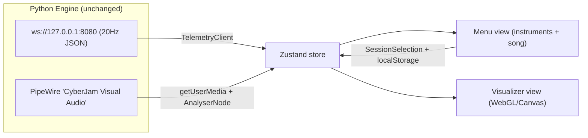
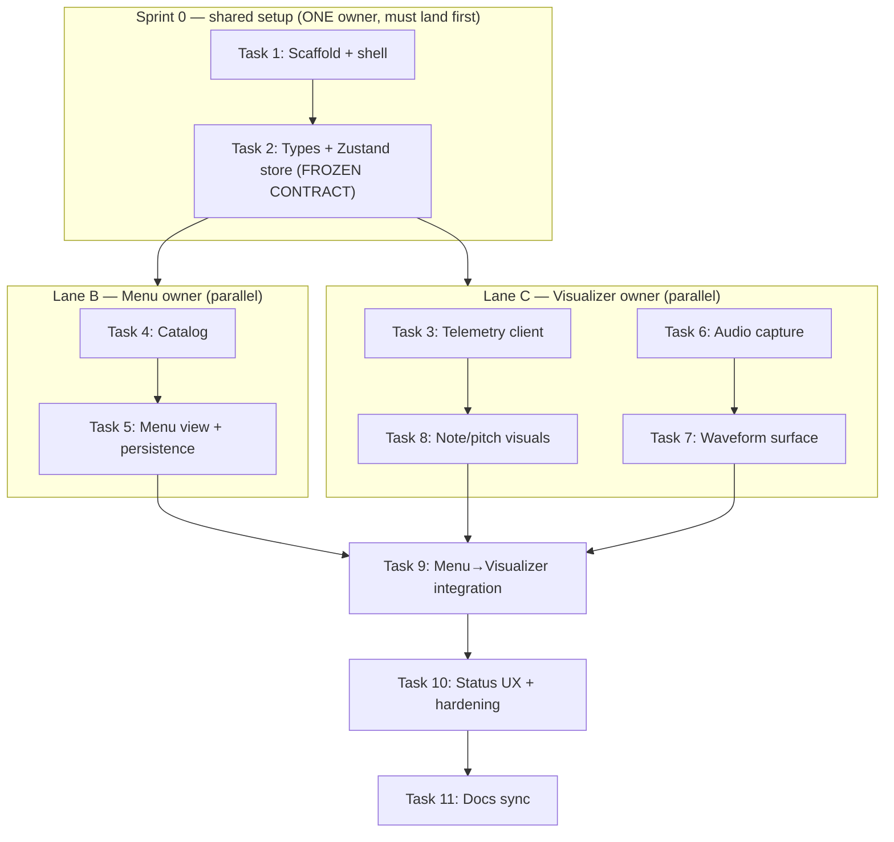

# React Visualizer — Implementation Plan

The **CyberJam Visualizer** is a standalone React web application for the installation. It
consumes the existing (unmodified) Python engine APIs and provides two features:

1. **Menu** — choose the song and the instruments for the session.
2. **Visualizer** — render the guitar notes you play (from DSP telemetry) and a live waveform
   of the audio, while the DAW/speakers produce the ML accompaniment audio.

**Two-window / two-screen layout:** one running dev-server instance serves three hash routes
(`#/` launcher, `#/menu`, `#/visualizer`). On load, the launcher **automatically attempts to open
both screens as separate browser windows** (one per screen); if the browser blocks the popups it
falls back to a single "Open both screens" button. The operator adjusts the Menu in real time on
screen 1 while screen 2 shows the full Visualizer. The two windows share the user's `selection`
live via the **BroadcastChannel** API (client-side only, no backend). There is no in-app
navigation chrome — each view fills its window.

> [!IMPORTANT]
> This subsystem does **not** modify the Python engine, open any new ports, or add a backend.
> It only *pulls* the documented contracts in
> [`contracts-and-apis.md`](./contracts-and-apis.md) and [`audio-and-routing.md`](./audio-and-routing.md).

---

## 1. Scope & Decisions

| Decision | Choice |
| :--- | :--- |
| Framework | Full **React** (no TouchDesigner, no new Python backend) |
| Build tool / language | **Vite** + **React** + **TypeScript** |
| Live audio path | PipeWire Virtual Source **`"CyberJam Visual Audio"`** via `navigator.mediaDevices.getUserMedia` → Web Audio `AnalyserNode` (Option B in [`audio-and-routing.md`](./audio-and-routing.md)) |
| Telemetry | WebSocket `ws://127.0.0.1:8080`, 20 Hz JSON |
| Visual rendering | **PixiJS** (2D WebGL/Canvas) — pinned in Task 1; chosen over react-three-fiber as the lighter, more direct fit for 2D waveform/spectrum/note-lane visuals driven from an `AnalyserNode` |
| State management | **Zustand** |
| Window / navigation model | **Two separate browser windows** (one per screen) via a dependency-free **hash router** (`#/`, `#/menu`, `#/visualizer`). The `#/` launcher **auto-opens both windows** (`window.open`) with a blocked-popup fallback button; no in-app nav chrome. Live cross-window `selection` sync via **BroadcastChannel** |
| Tests | **Vitest** + **React Testing Library** (jsdom) |
| Menu selections | **Local app state only** (React state + `localStorage`); no backend writes |
| ML instrument audio | Produced by the **DAW/speakers** (out of scope); the app visualizes only |

### Excluded on purpose
- **Raw UDP `:13000` PCM** — not accessible from a browser; the PipeWire Virtual Source path is
  used instead. Live audio therefore requires the engine launched with `--pipewire-loopback`.
- **OSC `:12000`** and **`CyberJam_Band` MIDI** — reference-only contracts. The app does not open
  them; it may *display* the documented roles (Ch 1 CC, Ch 2 bass, Ch 10 drums) as lane labels.

---

## 2. Contracts Consumed (from existing docs)

### 2.1 Telemetry WebSocket (`ws://127.0.0.1:8080`, 20 Hz)
One JSON object every **50 ms**. See [`contracts-and-apis.md`](./contracts-and-apis.md) §1 for the
authoritative schema.

```json
{
  "timestamp": 1763042450.123456,
  "bpm": 122.45,
  "detected_pitch": { "hz": 110.0, "note": "A2", "midi": 45, "key": "A" },
  "rms": 0.08412,
  "spectral_centroid_hz": 1420.55,
  "onset": true
}
```

Client guards to respect:
- `detected_pitch.hz == 0.0` / `note == "N/A"` → below noise gate; suppress the active-note display.
- `onset` is `true` only **once** per transient (consumed each broadcast) → do not re-trigger the
  pulse until a new `onset: true` arrives.
- `bpm` is clamped `40.0`–`240.0` upstream; treat socket data as untrusted and validate shape.

### 2.2 Live Audio (PipeWire Virtual Source)
Launch the engine with `--pipewire-loopback` to expose the system-wide virtual microphone
**`"CyberJam Visual Audio"`**. In the browser: `getUserMedia` selecting that device → `AnalyserNode`.

### 2.3 Engine defaults (reference)
From `cyberjam/config.py`: ws host/port `127.0.0.1:8080`, interval `50 ms`, default BPM `120`,
default key `E`.

---

## 3. Architecture

A single Vite + React + TS SPA with a two-view shell (Menu ↔ Visualizer). A typed data layer wraps
(a) the telemetry WebSocket and (b) the Web Audio capture, exposing live data through a Zustand
store. The Menu writes a `SessionSelection` into the store (persisted to `localStorage`); the
Visualizer reads both the live telemetry and the selection to render note/pitch/onset/waveform
visuals on a WebGL/Canvas surface. Everything is testable headless by mocking `WebSocket` and
`navigator.mediaDevices`.



---

## 4. Parallelization Plan (How Two People Work at Once)

The work is organized so the **Menu** and **Visualizer** features are built **in parallel** by two
owners after one short shared setup. The only serial part is **Sprint 0** (scaffold + frozen
contracts); everything else forks into two independent lanes that merge at the end.



**The frozen contract (produced in Task 2, do not change unilaterally after Sprint 0):**
- `TelemetryFrame` — the telemetry JSON shape (Visualizer lane reads it).
- `SessionSelection` — `{ songId, instrumentIds }` (Menu lane writes it, Visualizer lane reads it
  in Task 9).
- The Zustand store slices `latestFrame`, `connectionStatus`, `audioStatus`, `selection` and their
  actions.
- The `catalog.ts` instrument/song entry types (`id`, `lane`, `displayColor`, `midiChannel`,
  `referenceBpm`, `referenceKey`).

Freezing these four things up front is what lets the two lanes never block each other. If a change
to the contract becomes necessary, both owners agree first, then Task 2 is updated in a shared PR.

**Parallel-safe conventions (avoid merge collisions):**
- **File ownership by folder.** Menu lane owns `src/menu/**` and `src/data/catalog.ts`; Visualizer
  lane owns `src/visualizer/**` and `src/telemetry/**` and `src/audio/**`. Shared files
  (`src/store.ts`, `src/types.ts`, `src/config.ts`, `src/App.tsx`) are touched only in Sprint 0 and
  at the Task 9/10 merge points.
- **One sub-branch per lane** off the integration branch: `feat/react-visualizer-menu` and
  `feat/react-visualizer-visualizer`, both branched from `feat/react-visualizer` after Sprint 0
  lands. Rebase on the integration branch before opening the merge PR.
- **Mocked data unblocks both lanes.** Neither lane needs the live Python engine to build or test:
  the Menu lane uses the store directly; the Visualizer lane uses a mock `WebSocket` and mock
  `navigator.mediaDevices`. Live-engine verification happens at Task 9/10.
- **Each task stays independently demoable and test-covered** so a lane can be reviewed and merged
  without waiting for the other.

**Suggested assignment:**

| Lane | Owner | Tasks | Depends on | Blocks |
| :--- | :--- | :--- | :--- | :--- |
| Sprint 0 | Either (pair) | 1, 2 | — | everything |
| Lane B — Menu | Person 1 | 4, 5 | Task 2 | Task 9 |
| Lane C — Visualizer | Person 2 | 3, 6, 7, 8 | Task 2 | Task 9 |
| Integration | Either (pair) | 9, 10, 11 | Lanes B + C | — |

---

## 5. Task Breakdown (Spec-Driven)

Each task is a working, demoable increment, test-driven, with no orphaned code. The
**Lane** / **Depends on** / **Parallel with** fields define the execution order; tasks in different
lanes with the same dependency can run simultaneously.

### Sprint 0 — Shared setup (serial; must land before the lanes fork)

- [x] **Task 1: Scaffold the Vite + React + TS app with tooling and a two-view shell.** ✅ *Done (Sprint 0).*
  - *Lane:* Sprint 0 (shared). *Depends on:* none. *Parallel with:* none — blocks everything.
  - *Objective:* Create the project (Vite `react-ts` template) with Zustand, Vitest + React Testing
    Library, and a chosen visual lib (react-three-fiber or PixiJS) installed with pinned versions.
    Add an `App` shell with tab navigation between **Menu** and **Visualizer** views (placeholders).
  - *Guidance:* Put config constants (ws URL `ws://127.0.0.1:8080`, reconnect interval, audio device
    label `"CyberJam Visual Audio"`) in `src/config.ts`. Set up `vitest.config.ts` with jsdom.
  - *Tests:* Render `App`; assert both tab buttons exist and clicking toggles the active view.
  - *Demo:* `npm run dev` opens the app; user switches between empty Menu and Visualizer tabs;
    `npm test` passes.
  - *Result:* Project created under `visualizer/`. PixiJS pinned as the visual lib. Shell in
    `src/App.tsx` is a **dependency-free hash router** (`src/router.ts`) with three routes — `#/`
    (launcher), `#/menu`, `#/visualizer` — so each view opens in its own browser window (one per
    screen). The launcher **auto-opens both windows** on mount via `window.open` (`src/windows.ts`),
    falling back to an "Open both screens" button when popups are blocked; the in-app nav links were
    removed (title + debug bar only). Live cross-window `selection` sync via **BroadcastChannel**
    (`src/sync.ts` + `useSelectionSync`). `MenuView`/`VisualizerView` placeholders. Config constants
    in `src/config.ts`. `vitest.config.ts` uses jsdom. Verified: `npm run typecheck`, `npm test`
    (22 passing: launcher auto-open + blocked fallback, routing, store, router parsing, cross-window
    sync), and `npm run build` all green on branch `feat/react-visualizer`.
  - *Note:* The original in-page tab toggle was replaced by the two-window routing model, then the
    launcher was upgraded to auto-open both windows and the header nav links removed, per later
    requirements (one screen per view, real-time Menu, live Visualizer).

- [x] **Task 2: Define typed data contracts and the Zustand store. (FROZEN CONTRACT)** ✅ *Done (Sprint 0).*
  - *Lane:* Sprint 0 (shared). *Depends on:* Task 1. *Parallel with:* none — blocks both lanes.
  - *Objective:* Create TS types mirroring the telemetry JSON (`TelemetryFrame` with nested
    `detected_pitch`) and the `SessionSelection` type (selected song, selected instruments). Create a
    Zustand store holding `latestFrame`, `connectionStatus`, `audioStatus`, and `selection`, with
    actions to update each.
  - *Guidance:* Types must match [`contracts-and-apis.md`](./contracts-and-apis.md) exactly. Keep
    selection defaults aligned with engine defaults (BPM 120, key E) where relevant. **This task
    freezes the Menu↔Visualizer contract — after it lands, changes to these types require both lane
    owners to agree.**
  - *Tests:* Unit-test store actions (set frame, set selection, set statuses) and initial state.
  - *Demo:* A temporary debug panel renders `connectionStatus` and `selection` from the store.
  - *Result:* Frozen contract in `src/types.ts` (`TelemetryFrame`/`DetectedPitch` matching the JSON
    schema exactly, `SessionSelection` = `{ songId, instrumentIds }`, status unions, and the
    `InstrumentEntry`/`SongEntry` catalog types). Store in `src/store.ts` with `latestFrame`,
    `connectionStatus`, `audioStatus`, `selection` slices and actions (navigation moved to the hash
    router, so there is no `view` slice). Temporary `DebugPanel` renders status + selection. Engine
    defaults mirrored in `src/config.ts` (`DEFAULT_BPM`/`DEFAULT_KEY`). Verified by store unit
    tests.

### Lane B — Menu feature (parallel with Lane C)

- [x] **Task 4: Instrument & song data model + static catalog.** ✅ *Done (Lane B).*
  - *Lane:* B (Menu). *Depends on:* Task 2. *Parallel with:* all of Lane C.
  - *Objective:* Define the catalog of selectable **instruments** (mapped to documented roles/MIDI
    channels for display — Drums = Ch 10, Bass = Ch 2, Synth/FX = Ch 1) and **songs** (static list
    with title, reference BPM, reference key — e.g., the Cargo song). Provide a typed `catalog.ts`
    and selectors.
  - *Guidance:* Instrument entries carry a `displayColor` and `lane` used later by the Visualizer.
    Songs carry `referenceBpm`/`referenceKey` for Visualizer overlays. No network calls.
  - *Tests:* Catalog integrity (unique ids, valid channels, colors present); selector helpers.
  - *Demo:* A temporary list renders all instruments and songs from the catalog.
  - *Result:* Static catalog in `src/data/catalog.ts` using the frozen `InstrumentEntry`/`SongEntry`
    types (no network calls). Instruments: **Drums** (lane 0, MIDI Ch 10), **Bass** (lane 1, Ch 2),
    **Synth / FX** (lane 2, Ch 1), each with a `displayColor`; channels match
    [`contracts-and-apis.md`](./contracts-and-apis.md) §3. Songs: **Cargo** (`cargo-song`, 128 BPM,
    key E) and **Free Jam** (engine defaults, 120 BPM, key E). Selectors: `getInstrumentById`,
    `getSongById`, `getInstrumentsByIds` (catalog lane order, drops unknowns), `isValidInstrumentId`,
    `isValidSongId`. `MenuView` renders a temporary read-only list of the catalog (replaced by the
    interactive pickers in Task 5). Verified: `npm run typecheck`, `npm test` (37 passing, incl. 15
    new catalog integrity + selector tests), and `npm run build` all green on branch
    `feat/react-visualizer-menu-catalog`.

- [x] **Task 5: Menu view UI — selection and persistence.** ✅ *Done (Lane B).*
  - *Lane:* B (Menu). *Depends on:* Task 4. *Parallel with:* all of Lane C.
  - *Objective:* Build the Menu view: a song picker (single select) and an instrument picker
    (multi-select toggles), writing choices into the store's `selection` and persisting to
    `localStorage`; rehydrate on app load. Add a "Start / Go to Visualizer" action.
  - *Guidance:* Accessible controls (labeled inputs, keyboard operable, ARIA toggle state). Persist
    via a small `localStorage` wrapper; guard against corrupt stored JSON.
  - *Tests:* RTL — selecting a song and instruments updates the store; reload (re-mount with seeded
    `localStorage`) restores selection; corrupt storage falls back to defaults.
  - *Demo:* Pick the Cargo song + instruments, reload → selection persists; "Start" navigates to the
    Visualizer.
  - *Result:* `MenuView` (`src/views/MenuView.tsx`) renders a single-select song radio group and
    multi-select instrument toggle buttons (`aria-pressed`), writing through the store's `setSong` /
    `toggleInstrument` actions (so `useSelectionSync` mirrors changes to the Visualizer window). A
    small localStorage wrapper (`src/menu/persistence.ts`, key `cyberjam.selection`) persists on
    every change and rehydrates on mount; `loadSelection` sanitizes against the catalog — unknown
    song/instrument ids and corrupt/non-object JSON fall back to the empty selection, and instrument
    ids are de-duplicated. "Start / Go to Visualizer" is disabled until a song is chosen, then sets
    the hash to `#/visualizer`. Verified: `npm run typecheck`, `npm test` (49 passing, incl. 7
    persistence + 5 Menu RTL tests), and `npm run build` all green on branch
    `feat/react-visualizer-menu-catalog`.

### Lane C — Visualizer feature (parallel with Lane B)

- [ ] **Task 3: Telemetry WebSocket client with reconnect and validation.**
  - *Lane:* C (Visualizer). *Depends on:* Task 2. *Parallel with:* all of Lane B; independent of
    Tasks 6/7 within this lane.
  - *Objective:* Implement a `TelemetryClient` that connects to `ws://127.0.0.1:8080`, parses JSON
    into `TelemetryFrame`, validates/guards malformed frames, pushes valid frames into the store, and
    auto-reconnects with backoff. Expose a `useTelemetry()` hook tied to component lifecycle.
  - *Guidance:* Treat all socket data as untrusted — validate shape and clamp/guard before storing
    (e.g., ignore frames missing `detected_pitch`). Surface `connectionStatus`
    (`connecting | open | closed | error`). Build/test entirely against a mock `WebSocket` — no live
    engine required.
  - *Tests:* Mock `WebSocket`; assert valid frames update the store, malformed frames are dropped,
    and a close triggers a reconnect attempt.
  - *Demo:* With `run_session.py` running, the debug panel shows live `bpm`/`note`/`onset` at ~20 Hz;
    status flips to `open`. Without the engine, status shows reconnect attempts.

- [ ] **Task 6: Web Audio capture from the PipeWire Virtual Source.**
  - *Lane:* C (Visualizer). *Depends on:* Task 2. *Parallel with:* all of Lane B; independent of
    Tasks 3/8 within this lane.
  - *Objective:* Implement an `AudioCapture` module that enumerates input devices, selects
    `"CyberJam Visual Audio"` via `getUserMedia`, and exposes an `AnalyserNode` (time-domain +
    frequency getters). Provide a `useAudioCapture()` hook managing permission, start/stop, and
    `audioStatus` (`idle | requesting | active | denied | device-missing`).
  - *Guidance:* Require a user gesture to start audio (autoplay policy). Handle device-not-found with
    a clear message to launch the engine with `--pipewire-loopback`. Clean up tracks/AudioContext on
    unmount.
  - *Tests:* Mock `enumerateDevices`/`getUserMedia`; assert device selection by label, status
    transitions, denied/missing handling, and teardown.
  - *Demo:* "Enable Audio" activates capture; `audioStatus` shows `active` (or a clear message if the
    virtual device is absent).

- [ ] **Task 7: Live waveform/spectrum rendering surface.**
  - *Lane:* C (Visualizer). *Depends on:* Task 6. *Parallel with:* all of Lane B.
  - *Objective:* Build the WebGL/Canvas render surface driven by the `AnalyserNode`, drawing a
    real-time waveform and/or spectrum in a `requestAnimationFrame` loop.
  - *Guidance:* Decouple the render loop from React re-renders (read analyser buffers directly).
    Handle container resize; cap/cleanup the RAF loop on unmount to avoid leaks.
  - *Tests:* Pure buffer→drawing-data transform; mount/unmount starts/stops the RAF loop (mock RAF).
  - *Demo:* With audio active, playing guitar shows a live reacting waveform/spectrum.

- [ ] **Task 8: Note & pitch visualization from telemetry.**
  - *Lane:* C (Visualizer). *Depends on:* Task 3. *Parallel with:* all of Lane B.
  - *Objective:* Render the "notes you play" from telemetry: current `detected_pitch.note`/`midi`/
    `key`, a pitch history trail, and a flash/pulse on `onset`. Map `rms` to intensity and
    `spectral_centroid_hz` to color/brightness. Suppress display when `hz == 0.0` / `note == "N/A"`.
  - *Guidance:* Drive visuals from the store's `latestFrame`; keep a short rolling history (ring
    buffer) for the trail. Respect onset-once semantics.
  - *Tests:* Pure mapping functions (frame → visual props, midi → lane/position, centroid → color)
    with boundary cases (hz=0, note "N/A", onset toggling, clamped bpm/rms).
  - *Demo:* Playing a note shows the correct name + a pitch marker; strumming triggers onset pulses;
    silence clears the active-note indicator.

### Integration track (serial; after both lanes merge)

- [ ] **Task 9: Apply Menu selection to the Visualizer + reference overlays.**
  - *Lane:* Integration. *Depends on:* Lane B (Task 5) **and** Lane C (Tasks 7, 8). *Parallel with:*
    none — this is the first merge point.
  - *Objective:* Use the store's `selection` to drive Visualizer appearance: show only the chosen
    instrument lanes with their `displayColor`, and render song reference overlays (title,
    `referenceBpm` vs live `bpm`, `referenceKey` vs detected `key`). Label lanes with their MIDI roles
    (Ch 1/2/10).
  - *Guidance:* Integration task that ties Menu → Visualizer with no orphaned catalog data. Handle
    "no selection yet" with a sensible default view.
  - *Tests:* Given a seeded selection, assert only selected lanes render and overlays show the right
    reference values; changing selection updates the view.
  - *Demo:* Cargo song + chosen instruments now shape the live Visualizer (lanes, colors, tempo/key
    reference), with note + waveform visuals running together.

### Track D — Polish & integration hardening

- [ ] **Task 10: Connection/status UX, resilience, and end-to-end wiring.**
  - *Lane:* Integration. *Depends on:* Task 9. *Parallel with:* none.
  - *Objective:* Add a persistent status bar (WebSocket + audio status, reconnect indicator),
    graceful empty/error states when the engine isn't running, and finalize wiring so both views
    operate from the same live data layer. Remove temporary debug panels from earlier tasks.
  - *Guidance:* Clear operator-facing messages (e.g., "Engine offline — start `run_session.py`",
    "Virtual audio device not found — launch with `--pipewire-loopback`"). Ensure no leaks (sockets,
    RAF, AudioContext) across view switches.
  - *Tests:* Simulate engine-offline (ws closed) and audio-denied states; assert correct guidance and
    recovery on reconnect. Full smoke test of the data flow with mocked WebSocket + audio.
  - *Demo:* Start with the engine off → clear offline guidance; start the engine → everything connects
    live; switch tabs repeatedly with no errors/leaks.

### Documentation task (repo rule compliance)

- [ ] **Task 11: Keep this doc and the index synchronized.**
  - *Lane:* Integration. *Depends on:* Task 10. *Parallel with:* none.
  - *Objective:* As the React visualizer is implemented, keep this file accurate (stack, how it
    consumes the WebSocket/Web Audio contracts, how to run it alongside the engine including the
    required `--pipewire-loopback`, and the Menu `SessionSelection` model). Ensure the
    [`README.md`](./README.md) index entry stays correct.
  - *Guidance:* Reference exact ports/labels from [`contracts-and-apis.md`](./contracts-and-apis.md)
    and [`audio-and-routing.md`](./audio-and-routing.md). Prefer Fish-shell examples per repo
    convention.
  - *Tests:* N/A (docs) — verify links resolve and the schema matches the code.
  - *Demo:* A new contributor can run engine + visualizer from this doc alone.

---

## 6. Running

> [!NOTE]
> Sprint 0 (shell + data layer) is implemented. Live telemetry/audio arrive in Tasks 3/6.

Start the Python engine with the virtual audio source so the browser can capture live audio (on the
CachyOS install machine; Fish shell):

```fish
# Terminal 1 — engine with the visual audio virtual source
pw-jack .venv/bin/python run_session.py --pipewire-loopback
```

Start the React visualizer dev server (PowerShell shown for the Windows dev workstation; use the
equivalent in Fish/Bash):

```powershell
# Terminal 2 — React visualizer (dev server)
cd visualizer
npm install
npm run dev
```

**Two-screen workflow:** Vite prints a local URL (default `http://localhost:5173`). Open the root
URL (`http://localhost:5173/`) once — the launcher **automatically opens two windows**, the Menu
(`#/menu`) and the Visualizer (`#/visualizer`). Drag each to its screen:

- Screen 1 (operator): Menu — choose song + instruments in real time.
- Screen 2 (audience): Visualizer — full-screen live visuals.

If the browser blocks the automatic popups, the launcher shows an **"Open both screens"** button;
one click (a user gesture) opens them. Allowing popups for `localhost` makes it fully automatic.
Both windows run from the same dev-server instance and sync the `selection` live over
BroadcastChannel; a change in the Menu window appears immediately in the Visualizer window. Each
window connects to `ws://127.0.0.1:8080` for telemetry and prompts to enable audio from the
`"CyberJam Visual Audio"` device.

---

## 7. Repository Rule Notes

- All work happens on a feature branch per [`AGENTS.md`](../AGENTS.md) (e.g.,
  `feat/react-visualizer`).
- The Python engine is never modified.
- Raw UDP `:13000` is deliberately excluded (not browser-accessible).
- Live audio requires the engine launched with `--pipewire-loopback`.
